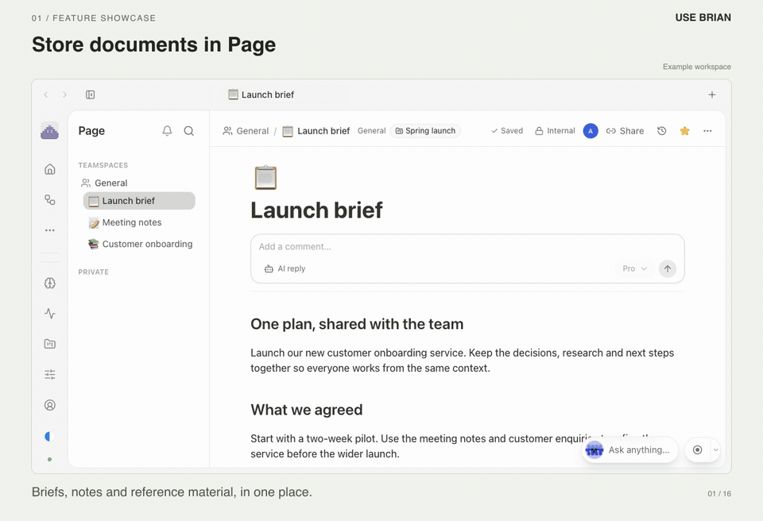

# Use Brian

### One shared brain for your team and AI.

Open-source. Hosted or self-hosted.

**[Try Brian](https://app.usebrian.ai)** · [Self-host](https://usebrian.ai/docs/open-source) · [Docs](https://usebrian.ai/docs)

<a href="assets/demo.mp4">Full demo (MP4)</a> · Current UI with a fictional example workspace

## Get work done

- **Page:** store documents, notes and shared knowledge.
- **Browser:** let Brian navigate and act through your browser extension.
- **Recordings:** turn meetings into transcripts and action items.
- **Tasks & CRM:** track owners, follow-ups and customer pipelines.
- **Workflows:** automate work with schedules, webhooks and events.

## Built for business and teams

- **Shared brain:** find, summarize and update connected information in chat.
- **Team chat:** people and AI agents work in the same conversation.
- **Scoped context:** separate work by department, project and clearance.
- **Action controls:** allow, require approval or block individual tools.
- **Your deployment:** use Brian Cloud or self-host on your infrastructure.

## Connect your tools and agents

- **Channels:** work from Slack, Telegram, WhatsApp, email and more.
- **Business tools:** connect your existing apps to the same brain.
- **Agents:** use specialist agents as tools, or let external agents access Brian through MCP.
- **Your app:** build on Brian with the assistant API.

[Getting started](https://usebrian.ai/docs/quickstart) · [Integrations & permissions](https://usebrian.ai/docs/tools) · [API & MCP](https://usebrian.ai/docs/api)

---

[AGPLv3](./LICENSE) · [Contributing](./CONTRIBUTING.md) · [Security](./SECURITY.md) · [Commercial licensing](mailto:sales@usebrian.ai) · [Implementation help](https://studio.usebrian.ai)
